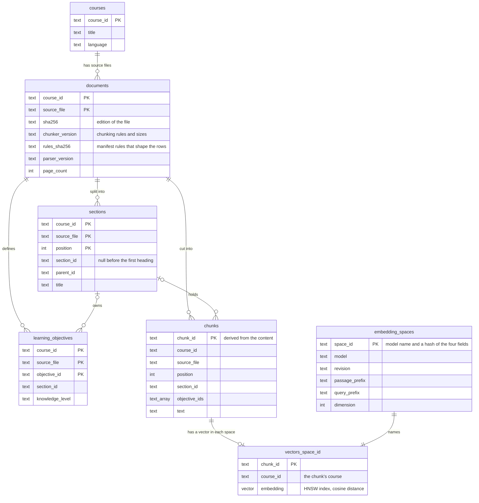
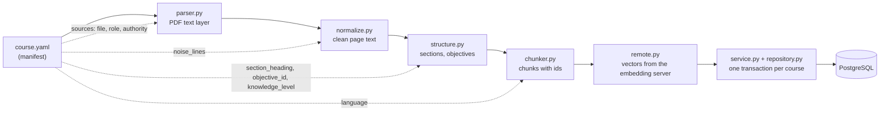

# Study Assistant — app

A domain-independent study assistant served as a FastAPI web service. Package: `study_assistant`.

How the app is tested, at which level and why: [TESTING.md](../TESTING.md).

> **Status: work in progress.** Both the app and the evaluation harness are under active development;
> the READMEs of each part describe what already works.

## Stack

- Python 3.14, [FastAPI](https://fastapi.tiangolo.com/), [Uvicorn](https://uvicorn.dev/),
  [pydantic-settings](https://docs.pydantic.dev/latest/concepts/pydantic_settings/) for configuration,
  [structlog](https://www.structlog.org/) for JSON logs, [PyYAML](https://pyyaml.org/) for course manifests,
  [pypdfium2](https://pypdfium2.readthedocs.io/) for the text layer of PDF sources,
  [LangChain text splitters](https://docs.langchain.com/oss/python/integrations/splitters) for cutting sections
  into chunks
- Embeddings: [Text Embeddings Inference](https://github.com/huggingface/text-embeddings-inference) (TEI, CPU
  image, ONNX Runtime backend) as a separate Compose service, called through LangChain's
  [`OpenAIEmbeddings`](https://docs.langchain.com/oss/python/integrations/embeddings/index) against its
  OpenAI-compatible endpoint; the app image holds no model and no PyTorch
- PostgreSQL 18 with [pgvector](https://github.com/pgvector/pgvector), reached through
  [psycopg 3](https://www.psycopg.org/psycopg3/) and its connection pool
- Docker Compose for running the app next to its database
- [Poetry 2](https://python-poetry.org/) for dependencies and the virtual environment
- Development: [pytest](https://docs.pytest.org/) with [Hypothesis](https://hypothesis.readthedocs.io/) for property
  tests, [ruff](https://docs.astral.sh/ruff/) (format and lint), [mypy](https://mypy.readthedocs.io/) (strict),
  [pre-commit](https://pre-commit.com/)

## Structure

```text
app/
├── pyproject.toml          # project metadata, dependencies, ruff / mypy / pytest config
├── poetry.lock
├── Dockerfile              # two-stage image: Poetry installs runtime dependencies, a non-root user runs the app
├── .dockerignore
├── src/study_assistant/
│   ├── main.py             # server entry point create_app(): settings from the environment
│   ├── composition.py      # build_app(settings): the one place where parts are built and wired
│   ├── settings.py         # typed settings; unknown APP_* variables stop startup
│   ├── logging_setup.py    # structlog, one JSON object per line on stdout
│   ├── errors.py           # the error envelope and the handlers that use it
│   ├── db.py               # Database protocol and the PostgreSQL pool, opened at startup, closed at shutdown
│   ├── migrate.py          # one-shot migration run: applies new SQL files, the embedding space's vector table, the two roles
│   ├── migrations/         # numbered SQL files (001_vector.sql, 002_corpus.sql, ...), applied in order
│   ├── courses/            # courses as data: nothing course-specific lives in the code
│   │   ├── models.py       # the course manifest: metadata, structure rules, source files
│   │   └── registry.py     # loads the enabled courses' manifests at startup; a bad one stops the app
│   ├── embed/              # text to vectors
│   │   ├── base.py         # embedding spaces (which model made a vector) and the Embedder protocol
│   │   └── remote.py       # the client of the embedding server: adds the prefixes, sends texts in batches, readiness ping, typed errors
│   ├── ingest/             # course sources to clean page text, the course structure and chunks, stored per course
│   │   ├── parser.py       # PDF text layer page by page, with the parser and PDF engine versions
│   │   ├── normalize.py    # header and footer lines, words split at line ends, spacing, Unicode form; page status
│   │   ├── structure.py    # sections and learning objectives found by the course's structure rules
│   │   ├── chunker.py      # chunks within sections: size cap, pages, objectives, content-derived ids, rules version
│   │   ├── service.py      # ingestion of a course: read every source, compute missing vectors, then add, keep, replace or remove documents
│   │   └── repository.py   # the corpus tables in PostgreSQL: one transaction per course, counts read back
│   └── api/                # HTTP layer: one router factory per group of endpoints, plus middleware
│       ├── middleware.py   # request id on every request; unhandled exceptions become a 500 envelope
│       ├── health.py
│       ├── courses.py
│       ├── admin.py        # endpoints behind the admin key: course ingestion
│       └── config.py
├── tools/
│   └── make_embedder_reference.py  # makes the reference vectors, in a throwaway container (see "Reference vectors")
└── tests/
    ├── integration/        # the real database driver without a server: startup and readiness while the database is down;
    │                       # the running embedding server against reference vectors (pytest -m embedding_server);
    │                       # data/embedder_reference.json: the reference vectors
    └── unit/               # in-process tests: the API through FastAPI's TestClient, parsing on the demo course PDF,
                            # the embedding client on a fake HTTP server
```

## Getting started

### With Docker (the app and its database)

From the repository root, with Docker running:

```powershell
Copy-Item .env.example .env                   # then set the passwords and ADMIN_API_KEY in .env
$env:GIT_COMMIT = git rev-parse --short HEAD  # optional: shown by /v1/config
docker compose up -d --build --wait
docker compose logs migrate --no-log-prefix   # which migration files were applied
curl.exe -i http://127.0.0.1:8000/ready
```

The stack starts in order: the database, then `migrate`, a one-shot run of the same image that applies new
migration files as the database owner and prepares the app's role and the read-only role; next to it
`model-check` checks the model files and `embedder` loads the model; then the app, only after `migrate` has
exited without an error and `embedder` is healthy. `--wait` returns once the database, the embedding server and
the app are healthy (the app counts as healthy when `/ready` answers 200); `docker compose ps -a` shows `migrate`
and `model-check` as exited with code 0. The model files must be in place first (see "Model files" below).

`docker compose down` stops the stack and keeps the database volume; `docker compose down -v` also
deletes it, which is needed after changing `DB_OWNER` or `DB_PASSWORD`, because PostgreSQL sets the owner
only when the volume is first created. The database port is published on `127.0.0.1` only
(`DB_PUBLISHED_PORT`), for checks that read stored rows with the read-only role (`DB_READER_USER`); as the owner,
use `docker compose exec db psql -U study_assistant -d study_assistant` (the `DB_OWNER` and `DB_NAME` from `.env`).

Compose mounts the repository's `courses/` folder read-only and enables the courses in
`APP_COURSES__ENABLED` (`demo` in `.env.example`); check with `curl.exe http://127.0.0.1:8000/v1/courses`.
Course sources are mounted read-only too: `courses/` (the demo course's PDF is committed) and one more folder
for a course whose material stays on this machine (`LOCAL_COURSE_ID`, `LOCAL_COURSE_SOURCES`). Then ingest a
course and look at what is stored:

```powershell
$key = (Select-String '^ADMIN_API_KEY=(.*)' .env).Matches.Groups[1].Value
curl.exe -X POST -H "X-Admin-Key: $key" http://127.0.0.1:8000/v1/admin/courses/demo/ingest
curl.exe http://127.0.0.1:8000/v1/courses/demo
```

### Model files

The embedding server reads the files of the pinned model revision from `models/<model>/<revision>/` in the
repository root (not committed, about 490 MB). Before it starts, `model-check` compares every file with the SHA-256
committed in [`models.sha256`](../models.sha256); a missing or changed file is named in
`docker compose logs model-check` and the server does not start. The server never downloads anything itself.

Download them once from the repository root, in a throwaway container:

```powershell
docker run --rm -v "${PWD}/models:/models" python:3.14.8-slim-trixie sh -c "pip install -q huggingface-hub==2.2.0 && hf download intfloat/multilingual-e5-small 1_Pooling/config.json config.json modules.json onnx/model.onnx sentence_bert_config.json sentencepiece.bpe.model special_tokens_map.json tokenizer.json tokenizer_config.json --revision 614241f622f53c4eeff9890bdc4f31cfecc418b3 --local-dir /models/intfloat/multilingual-e5-small/614241f622f53c4eeff9890bdc4f31cfecc418b3"
```

To change the model or its revision: download the new revision's files the same way; check that the SHA-256 of
`onnx/model.onnx` equals the one Hugging Face shows for that file; write the new hashes into `models.sha256`
(`docker run --rm -v "${PWD}/models/<model>/<revision>:/m:ro" -w /m busybox:1.37.0 sha256sum <files>`); change
`APP_EMBEDDING__*` in `.env` and `.env.example`; commit both files together. The new revision is a new embedding
space, so the next ingestion computes every vector again. A new model or revision also needs new reference vectors
for the reference-vector check (see "Reference vectors" under "Development checks"). If `model-check` fails while nothing
was changed, the local files are damaged: download them again and leave `models.sha256` as it is.

### Without Docker

Requires Python 3.14 and Poetry 2. All commands run from `app/`.

```powershell
poetry install --with lint
$env:APP_DB__PASSWORD = "change-me"
poetry run uvicorn study_assistant.main:create_app --factory
```

The service listens on `http://127.0.0.1:8000`; interactive API docs are at `/docs`. It starts even
when no database is reachable: `/health` answers 200 and `/ready` 503. On Windows, Uvicorn runs on
an event loop that async psycopg cannot use, so the database is reachable only when the app runs in
Docker.

## Configuration

Everything the local stack is configured with is in one file: the repository root's
[`.env.example`](../.env.example), copied to `.env`. It lists every value with what it means and which app
setting (`APP_*`) it becomes. `compose.yaml` takes each value from `.env` (a missing one stops Compose with
its name) and gives each service only the values it needs: the app gets the app role's password, never the
database owner's.

The app reads its settings from the process environment only, as `APP_*` variables (nested groups as
`APP_GROUP__FIELD`, e.g. `APP_DB__HOST`), and does not load a `.env` file itself. An `APP_*` variable that
matches no setting stops startup with the unknown names listed, so a typo never falls back to a default
silently. Defaults in the code matter only for unit tests and runs without Compose; `APP_DB__PASSWORD` has
none. `GET /v1/config` shows the effective values with every secret masked.

The migration run (`python -m study_assistant.migrate`) reads the same database variables with the owner's
user and password, plus `APP_SERVER_ROLE__NAME` / `APP_SERVER_ROLE__PASSWORD` for the app's role and
`APP_READER_ROLE__NAME` / `APP_READER_ROLE__PASSWORD` for the read-only role; the app server refuses these.
The app server needs `APP_ADMIN__API_KEY` (at least 16 characters) and does not start without it.

In PowerShell, set a variable for the current window before starting the server:

```powershell
$env:APP_LOG_LEVEL = "DEBUG"
poetry run uvicorn study_assistant.main:create_app --factory
```

Logs are JSON lines on stdout, each with the request id while a request is handled; uvicorn's own
startup and access lines stay plain text.

## Database

The schema is created by numbered SQL files in `src/study_assistant/migrations/`. The migration run applies
the files the database has not seen yet, in number order, each in its own transaction together with its row
in the `schema_migrations` journal, so a failing file leaves nothing behind. The journal keeps each file's
SHA-256: an applied file must never be edited (the run stops and names it); a change goes into a new file
with the next number.

Then the run prepares the configured embedding space (`APP_EMBEDDING__*`): it registers the space in
`embedding_spaces` and creates its vector table `vectors_<space id>` with an HNSW index for cosine distance. A
space that is already registered is left as it is; one registered with another vector length stops the run. A new
model, revision or prefix is a new space with its own table, so vectors of two models are never mixed, and the
tables of earlier spaces stay.

After that, the run creates two roles or resets their passwords, each starting from no table rights:
the app's role (`DB_APP_USER`) may select, insert, update and delete rows of every table and only read the
journal and the space registry; the read-only role (`DB_READER_USER`) may only select. The app connects as its
role, so it cannot create, alter or drop anything; only the migration run uses the owner.

Every row carries its course id; a document's sections, objectives and chunks are deleted with it, and a chunk's
vectors with the chunk.



## Ingestion

`POST /v1/admin/courses/{course_id}/ingest` turns a course's source files into rows of the tables above.
Each link of the chain takes its rules from the course manifest; the code holds none of them:



Every source is read and chunked, and the missing vectors are computed, before anything is written, so a source
that cannot be read (422 `ingest_failed`, naming the file) or an embedding server that cannot be reached (503
`embedding_unavailable`) or answers with an error (502 `embedding_failed`) leaves the database as it was. Then, in
one transaction per course:

- a document whose file, parser, chunking rules and shaping manifest values are all unchanged is kept as it is;
- a changed document is deleted with all its rows and written again;
- a document the manifest no longer lists is deleted;
- every chunk gets one vector in the configured embedding space, stored in that space's table; an unchanged
  document whose chunks have no vectors there (after a change of model) gets only its vectors (outcome
  `embedded`). Vectors are deleted with their chunks.

The vectors are computed outside the transaction, so no database connection waits for the embedding server. If
another ingestion of the same course changed it in the meantime so that a chunk needs a vector that was not
computed, the ingestion stops with 409 `ingest_conflict` and nothing written; running it again is safe.

Ingesting the same files twice therefore changes nothing, and chunk ids stay the same. The answer lists what
happened to each file, the counts read back from the database, the embedding space and the number of the
course's chunks with a vector in it. Two ingestions of one course run one
after the other. Chunk length and overlap are settings (`APP_INGEST__CHUNK_SIZE`, `APP_INGEST__CHUNK_OVERLAP`);
changing them rebuilds every document on the next ingestion. Only PDF sources are ingested so far; question
banks are not chunked.

## API

| Method | Path | Purpose |
|---|---|---|
| `GET` | `/health` | Liveness: `{"status": "ok"}` while the process is serving HTTP |
| `GET` | `/v1/config` | Effective configuration: app version and settings, every secret masked |
| `GET` | `/ready` | Readiness: 200 `{"status": "ok", "checks": {"db": "ok", "embedder": "ok"}}` when the database and the embedding server answer, otherwise 503 in the error envelope naming each failed check |
| `GET` | `/v1/courses` | The enabled courses in the configured order: `id`, `title`, `description`, `language` |
| `GET` | `/v1/courses/{course_id}` | One course, its stored `corpus` counts (documents, sections, learning objectives, chunks), the configured `embedding_space` and the number of the course's `vectors` in it (0 after a change of model until the next ingestion); 404 for a course not served |
| `POST` | `/v1/admin/courses/{course_id}/ingest` | Ingest a course (needs the `X-Admin-Key` header, otherwise 401): per-file outcome, removed files, stored counts, embedding space and vector count |


## Errors and request ids

Every response carries an `X-Request-ID` header. A client may send its own id (letters, digits,
`.`, `_`, `-`, up to 128 characters) and gets it back; otherwise the app generates a UUID. The same
id is in every log line written while the request is handled, so a response can be matched with its
logs.

Every error has the status code that fits it and one body format:

```json
{"status": "error", "error": {"code": "not_found", "message": "Not Found"}, "request_id": "..."}
```

`code` is stable for programs to read: `not_found`, `method_not_allowed`, `unauthorized`, `ingest_failed`,
`ingest_conflict`, `embedding_failed`, `embedding_unavailable`,
`internal_server_error` and so on. A 422 also lists `details` with the location and reason of each invalid field; the values that were
sent are not echoed. A 503 from `/ready` lists the failed checks the same way, for example
`{"loc": ["checks", "db"], "msg": "unavailable"}`. A 500 never shows the exception; it is written to the log with the
traceback and the request id.

```powershell
curl.exe -i http://127.0.0.1:8000/nope
curl.exe -i -H "X-Request-ID: my-test-1" http://127.0.0.1:8000/health
```

## Development checks

```powershell
poetry run ruff format --check .
poetry run ruff check .
poetry run mypy .
poetry run pytest
```

A plain `pytest` needs no server and no model files. The reference-vector check below needs the running stack.

### Reference vectors

**What they are.** `tests/integration/data/embedder_reference.json` holds the vectors that the model's reference
implementation (sentence-transformers on CPU, the pinned revision downloaded from Hugging Face) gives for five
invented texts: four passages, among them a Russian text and one longer than the model's limit of 512 tokens, and
one query. The file also names the model, the revision, the passage and query prefixes and the library versions
the vectors were made with.

**How the check uses them.** `tests/integration/test_embedding_server_reference.py` sends the same texts through
the app's own embedding client to the running embedding server, with the model, revision and prefixes named in
the file, and expects every vector to point the same way as the reference (cosine at least 0.9999). It sees what
an HTTP status cannot: a lost or wrong prefix, token ids sent instead of text, a long text cut in another place,
other model files, a changed server image or client library. It needs the stack (`docker compose up -d --wait`)
and runs only when asked for:

```powershell
poetry run pytest -m embedding_server
```

A plain `pytest` leaves it out (marker `embedding_server`); asked for without a server, it fails instead of being
skipped, so a check that did not run can never look like one that passed. Run it after any change of the
embedding client, its libraries, the server image or the model files: none of these is part of the embedding
space, so only this comparison shows that the vectors stayed the same.

**When to make new reference vectors.** Only for another model, revision or prefixes. Never because the check
fails after an upgrade of the server image, the client or its libraries: that failure is the finding, and new
reference vectors would hide it.

**How.** `tools/make_embedder_reference.py` makes the file in a throwaway container, with the library versions
pinned to those the current file was made with. From `app/`:

```powershell
docker run --rm -v "${PWD}/tools:/tools:ro" -v "${PWD}/tests/integration/data:/out" python:3.14.8-slim-trixie sh -c "pip install -q --root-user-action=ignore --index-url https://download.pytorch.org/whl/cpu torch==2.14.1 && pip install -q --root-user-action=ignore sentence-transformers==6.1.0 transformers==5.20.1 && python /tools/make_embedder_reference.py --out /out/embedder_reference.json"
```

It downloads about 700 MB (the libraries and the model). For another model, add the values of
`APP_EMBEDDING__*` from `.env` at the end: `--model <model> --revision <revision> --passage-prefix "<prefix>"
--query-prefix "<prefix>"`. Run with the defaults, the command gives exactly the vectors in the committed file;
`git diff` on the file then shows no change. Commit the new file together with the `.env.example` change, then
run the check against the stack with the new model.

The same checks, a secret scan and a check that app code contains no course-specific names run as
pre-commit hooks from the repository root:

```powershell
app\.venv\Scripts\pre-commit install          # once, from the repository root
app\.venv\Scripts\pre-commit run --all-files
```
